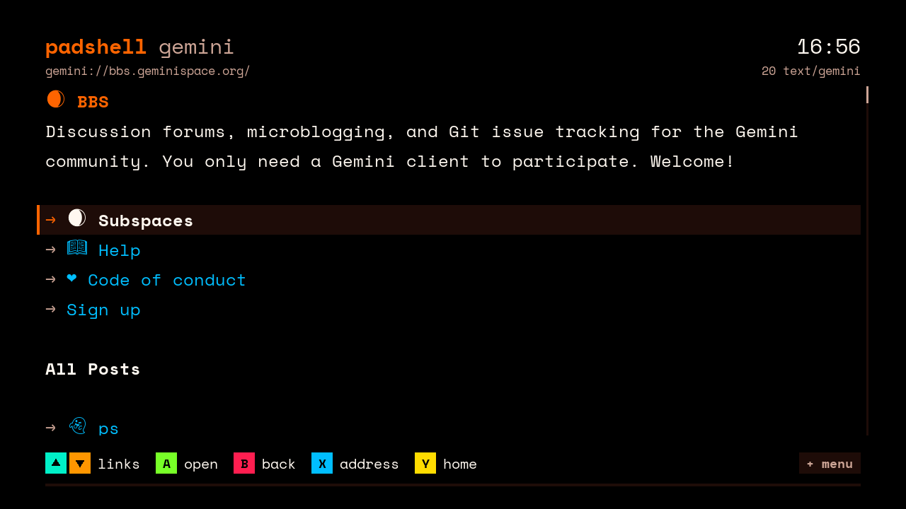

# padshell

A Nintendo Switch homebrew "shell": a set of apps in one process, driven
entirely by the gamepad. It has two apps so far, switched with − :
**gemini** (opens at launch), a browser for the
[Gemini protocol](https://geminiprotocol.net/), and **notes**, a text editor
you type into with phone-style multi-tap on the face buttons and D-pad (no
on-screen keyboard).


The same code builds for desktop Linux (SDL2), so you can iterate without
copying to the console.

## Screen

A slim top bar (brand, counts, clock), a large document with characters
coloured by kind, and a status line of flat button badges with their groups.
While a character is being selected it appears at the cursor in its button's
colour, the status line shows its cycle, and a bar counts down to the
commit. Tags on the right show caps and the current mode.

## Settings: theme, font and starfield

Press − and choose *settings*. It has three lines: the colour **theme**, the
**font**, and the moving **starfield** (on/off), each independent of the
others. Highlight one and press A, or D-pad left/right, to change it while
the menu stays open as a preview; B goes back. They are saved in
`settings.ini` next to the notes (`theme=sunset`, `font=space-mono`,
`starfield=on`).

The starfield draws stars drifting slowly towards you behind the text,
with any theme (on the light *day* theme they are dark specks).


| Theme | Look |
|---|---|
| **sunset** (default) | Pure black, hot orange accent with magenta and lime |
| **dusk** | Violet-black, violet accent |
| **lava** | Warm black, red-orange accent; edit mode is crimson-pink to stay distinct |
| **gold** | Black, amber accent; the caps tag is cyan to stand apart |
| **tropic** | Teal-black, orange accent |
| **rose** | Pink-black, rose accent |
| **ember** | Warm dark brown, coral and amber |
| **midnight** | Violet-black, pink accent |
| **moon** | Pure black with a white accent, pure white text and saturated cool colours |
| **ocean** | Deep navy, cyan accent |
| **carbon** | Neutral black, IBM blue |
| **neon** | Pure black, electric magenta, lime and cyan |
| **cyber** | Pure black, electric cyan accent with yellow and magenta |
| **vapor** | Violet-black, hot pink accent, softer neons |
| **ice** | Blue-black, electric periwinkle accent with cyan and mint |
| **night** | Dim, for dark rooms: everything held at 4.8–8:1 contrast, warm white text, soft amber accent |
| **space** | Black, white text, pale blue accent and cool colours; made for the starfield |
| **day** | Light paper, darkened ink colours for text |

Fonts: **Space Mono** (default), JetBrains Mono, IBM Plex Mono, Fira Mono,
DejaVu Sans Mono and Courier Prime.

Conventions shared by every theme (`src/skins/family.h`):

* **Contrast for TVs.** Dark themes use near-black backgrounds, saturated
  accents (at least 4.9:1 against the background, and for dark text on
  them) and greys at 6.8:1 or better, so they hold up on cheap panels.
* **Button colours.** Each button position has its own colour wherever it
  appears: bottom green, right red, left blue, top yellow (Xbox A, B, X, Y;
  on a Switch controller B, A, Y, X), D-pad down orange, left violet, up
  teal, right magenta. Exact shades vary by theme.
* **Character colours.** In the document, capitals, digits, brackets,
  quotes, operators and other punctuation each have their own colour.
* **Mode colours.** Cursor and mode tag use the theme's accent for letters,
  green while ZL is held and red while ZR is held. The "ABC" tag lights up
  for caps.

The layout is `src/skins/layout.cpp`; a theme is a `Palette` in
`themes::` (`family.h`) listed in `kThemes` in `layout.cpp`, and a font is a
Regular/Bold pair listed in `kFonts` there. Skins receive a read-only view of the shell
and editor state (`src/skin.h`), so a new layout needs no changes to the
editor or input code.

## Controls

Buttons are named as printed on a **Switch** controller. (The design came from
an Xbox layout: Xbox A/B/X/Y sit where the Switch has B/A/Y/X, and
LT/RT/LB are ZL/ZR/L.)

| Button | Use |
|---|---|
| B / A / Y / X, D-pad | character groups |
| ZL (hold) | numbers and symbols (green cursor) |
| ZR (hold) | newline, space, backspace, delete line; D-pad moves the cursor (red cursor) |
| L | toggle uppercase |
| + | editor menu (save, quit). In menus: A select, B cancel, D-pad up/down move |
| − | app menu |

### Entering text

Press a character button to preview the first character of its group, and
press it again within a second to cycle. The character is committed after one
second without input, or when a character from another group is selected.
B B, wait, Y, wait types `bd`. For two characters from the same group, wait for
the first to commit. Whether a press cycles depends on whether the *current*
character is in the pressed group, so symbol groups that share `"` `'` `.`
continue each other's cycle.

| Button | Letters | ZL held |
|---|---|---|
| B | `a b c` | `1 2 3` |
| Y | `d e f` | `4 5 6` |
| X | `g h i` | `7 8 9` |
| A | `j k l` | `0 .` |
| D-pad down | `m n o` | `. , ? ! _ : ; \|` |
| D-pad left | `p q r s` | `( [ { < " '` |
| D-pad up | `t u v` | `- = + * / ^ ~ # % @` |
| D-pad right | `w x y z` | `) ] } > " '` |

Releasing ZL commits the pending character.

**Uppercase:** L toggles it, including for the character being previewed, and
restarts that character's one-second timer. It turns off after the next
committed character. If L is held while characters are committed, it stays on
while held, and after release it stays on until the next commit (or another
press of L).

**Commands (hold ZR):** B newline, Y space, A backspace, X delete the
current line, and the D-pad moves the cursor (it auto-repeats while held).
Deleting on the last line is the spec's "delete the last segment"
(`first\nsecond` → `first`, `first\n` → `first`, a single line is
cleared); on another line it removes that line. Pressing ZR, or any
command, commits the pending character first. ZR takes precedence when both
triggers are held.

Text goes in at the cursor, which starts at the end of the document when it
is opened; the view scrolls to keep it visible and the top bar shows its
line and column. The editor works on
`sdmc:/switch/padshell/notes.txt` on the Switch, or
`~/.local/share/padshell/notes.txt` on desktop (override with
`PADSHELL_DATA`). It saves automatically when you quit.

### Desktop testing

On desktop the keyboard acts as a gamepad, for testing without a controller:
`I/L/K/J` top/right/bottom/left face button, arrows D-pad, `Q/E` L/R, `Z/C`
ZL/ZR, `Return` +, `Tab` −, `Esc` quit. `tools/xdo_type.py "text"` types a
string through it with xdotool. On-screen labels follow the platform (Xbox
labels on desktop).

## Gemini browser



| Button | Action |
|---|---|
| D-pad up/down | Previous/next link (scrolls instead when the next link is far away) |
| D-pad left/right | Page up/down |
| Left or right stick | Smooth scrolling, faster the further you push |
| A | Open the selected link |
| B | Back (stops loading while a page is loading) |
| L / R | Back / forward |
| Y | Type an address |
| X | Home page, with bookmarks |
| + | Menu: bookmark or remove, bookmarks, address, reload, trust a changed certificate |

* **Gemtext** is rendered: headings, links (→, with "↗ https" on links to
  other protocols, which can't be opened), list items, quotes and
  preformatted blocks (not wrapped). Other text types are shown as plain
  text.
* **Input** (status 10/11) and the address bar use the same multi-tap as
  notes; ZR + B (newline) sends, or + → send / cancel. Sensitive input
  (11) is masked.
* **Bookmarks** are stored as gemtext in `bookmarks.gmi` next to the notes
  and listed on the home page. Selecting one there and choosing *remove
  this bookmark* in the + menu deletes it.
* **Certificates** use trust on first use: a host's certificate SHA-256
  is remembered in `known_hosts` on the first visit, and a later change is
  refused with an explanation until you choose *trust new certificate*.
  Client certificates are not supported.
* **Emoji** and other symbols missing from the chosen font come from DejaVu
  Sans Mono, then Noto Emoji (monochrome, so they follow the theme colour).
* Redirects are followed up to five times; responses are limited to 8 MB;
  network work runs on a background thread with a 15 s timeout.

`tools/gemfetch` (desktop only) fetches one URL with the same client and
prints the response, for testing.

## Building

### Desktop (Linux)

Needs CMake, a C++20 compiler, SDL2 and SDL2_ttf
(Arch: `pacman -S cmake sdl2-compat sdl2_ttf`). The first configure
downloads and builds mbedtls 2.28.10, the version the Switch uses
(distributions now ship 3.x/4.x, whose API differs).

```sh
cmake -S . -B build && cmake --build build -j
ctest --test-dir build          # unit tests
./build/padshell
```

### Switch (.nro)

With devkitPro installed natively (`dkp-pacman -S switch-dev switch-sdl2 switch-sdl2_ttf switch-mbedtls`):

```sh
/opt/devkitpro/portlibs/switch/bin/aarch64-none-elf-cmake -S . -B build-switch
cmake --build build-switch -j
```

Or use the official container, with no local install:

```sh
./tools/build-switch.sh         # -> build-switch/padshell.nro
```

### Running on the console

* **Copy:** put `padshell.nro` in `sdmc:/switch/` and start it from the
  Homebrew Menu.
* **Over Wi-Fi:** in the Homebrew Menu press Y (netloader), then run
  `nxlink -s build-switch/padshell.nro`. `-s` shows the app's log output in
  your terminal.
* Start the Homebrew Menu by holding R while launching a game (title
  override), not from the Album. Album/applet mode gives apps much less memory.

## Layout

```
src/
  main.cpp          SDL setup and main loop
  platform.*        Switch and desktop differences: paths, init, controller mapping
  pad.h             logical gamepad state + edge/repeat tracking
  multitap.*        multi-tap text entry (pure logic, unit tested)
  textbuffer.*      editable UTF-8 text
  gfx.*             drawing helpers, cached monospace glyphs
  shell.*           app launcher and app switching (drawing is done by skins)
  skin.*            skin interface, registry and shared helpers
  skins/            the layout (layout.cpp) and its themes (family.h)
  app.h             interface every app implements
  apps/editor.*     the text editor
  apps/browser.*    the Gemini browser
  gemini/           URL handling, gemtext parsing, TLS client (mbedtls)
  textinput.h       single-line multi-tap field (address bar, prompts)
tests/              host-only unit tests
romfs/              bundled fonts: DejaVu Sans Mono, plus JetBrains Mono,
                    IBM Plex Mono, Fira Mono, Space Mono, Courier Prime and
                    Noto Emoji under the SIL OFL (licences alongside)
tools/              build script, xdotool typing helper for desktop testing
```

### Adding an app

Subclass `App` (`title`, `heading`, `update`, `render`, and optionally
`onEnter`/`onLeave`), then register it in `main.cpp` with `shell.add(...)`;
the first app added opens at launch. Apps draw through the skin (`skin.h`)
and those that need text input use `MultiTap` or the single-line
`TextInput`.

## Licence

MIT, see [LICENSE](LICENSE). The bundled fonts keep their own licences
(DejaVu, and the SIL Open Font License for the others), included next to
them in `romfs/fonts/`.
