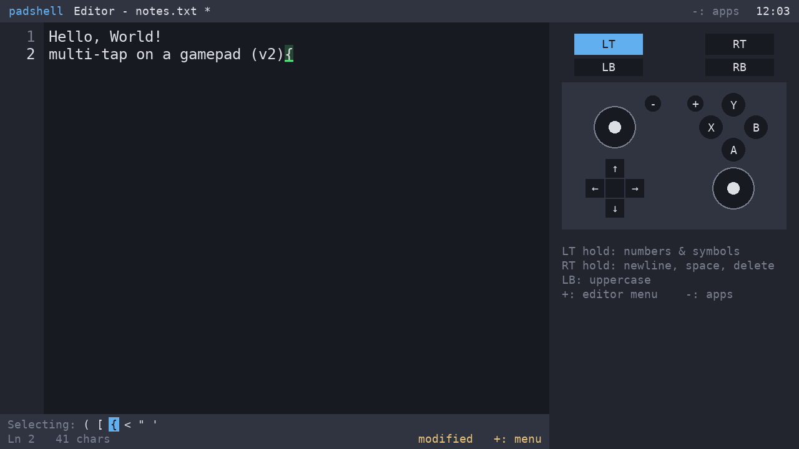
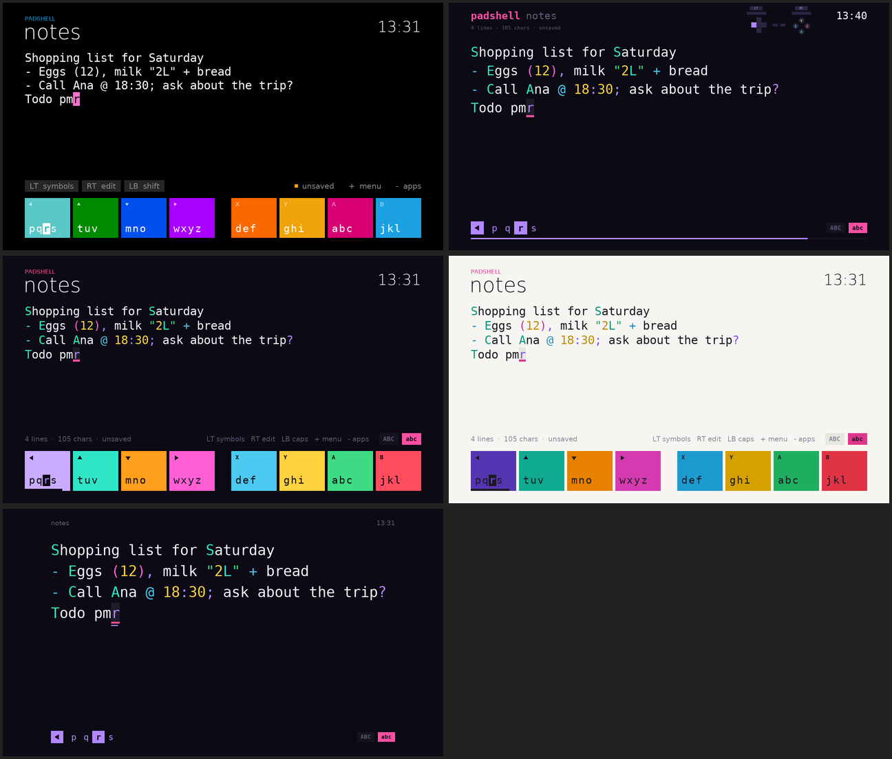

# padshell

A Nintendo Switch homebrew "shell": a set of apps in one process, driven
entirely by the gamepad. The first app is a text editor you type into with
phone-style multi-tap on the face buttons and D-pad, with no on-screen keyboard.



The same code builds for desktop Linux (SDL2), so you can iterate without
copying to the console.

## Screen

The editor shows the document with a cursor at the end. While a character is
being selected it appears at the cursor and its group shows the cycle. Every
style also shows the eight button groups (or, while a trigger is held, the
symbol groups or edit commands), lights up the buttons being pressed, and
indicates the current mode.

## Styles

Five variations on one Metro-style design, picked in the − app menu:
highlight *style* and press A, or D-pad left/right, to cycle while the menu
stays open as a preview. The choice is saved in `settings.ini` next to the
notes.



| Style | Look |
|---|---|
| **metro** (default) | Black canvas, big light heading, flat colour tiles in controller order with per-mode palettes, TV-safe margins. |
| **ameno** | After the ameno TV web app: slim top bar (brand, counts, small controller diagram, clock), large document, and a status line of flat button badges with their groups, the pending character's cycle, mode tags and a commit timer. |
| **keys** | Metro's layout where every tile keeps its button's own colour in all modes; the mode shows in the cursor and tags, and a bar on the pending tile counts down to the commit. |
| **light** | The same as keys in a light, daytime theme. |
| **focus** | Distraction-free: a quiet top line and a large centred column of text. The status line stays muted while you write and comes up in colour when you act; the commit timer sits under the pending character. |

All but metro share the ameno conventions (`src/skins/family.h`):

* **Button colours.** Each button position has its own colour wherever it
  appears: bottom green, right red, left blue, top yellow (Xbox A, B, X, Y;
  on a Switch controller B, A, Y, X), D-pad down orange, left violet, up
  teal, right magenta.
* **Character colours.** In the document, capitals are teal, digits yellow,
  brackets magenta, quotes green, operators blue, other punctuation violet.
* **Mode colours.** Cursor and mode tag: pink for letters, green while ZL is
  held, red while ZR is held. The "ABC" tag lights up in yellow for caps.

Each skin is one file in `src/skins/`. Skins receive a read-only view of the
shell and editor state (`src/skin.h`) and draw everything themselves, so a
new look needs no changes to the editor or input code.

## Controls

Buttons are named as printed on a **Switch** controller. (The design came from
an Xbox layout: Xbox A/B/X/Y sit where the Switch has B/A/Y/X, and
LT/RT/LB are ZL/ZR/L.)

| Button | Use |
|---|---|
| B / A / Y / X, D-pad | character groups |
| ZL (hold) | numbers and symbols (green cursor) |
| ZR (hold) | newline, space, backspace, delete line (red cursor) |
| L | toggle uppercase |
| + | editor menu (save, quit). In menus: A select, B cancel, D-pad up/down move |
| − | app menu |

### Entering text

Press a character button to preview the first character of its group, and
press it again within a second to cycle. The character is committed after one
second without input, or when a character from another group is selected.
B B, wait, Y, wait types `bd`. For two characters from the same group, wait for
the first to commit. Whether a press cycles depends on whether the *current*
character is in the pressed group, so symbol groups that share `"` `'` `.`
continue each other's cycle.

| Button | Letters | ZL held |
|---|---|---|
| B | `a b c` | `1 2 3` |
| Y | `d e f` | `4 5 6` |
| X | `g h i` | `7 8 9` |
| A | `j k l` | `0 .` |
| D-pad down | `m n o` | `. , ? ! _ : ; \|` |
| D-pad left | `p q r s` | `( [ { < " '` |
| D-pad up | `t u v` | `- = + * / ^ ~ # % @` |
| D-pad right | `w x y z` | `) ] } > " '` |

Releasing ZL commits the pending character.

**Uppercase:** L toggles it, including for the character being previewed, and
restarts that character's one-second timer. It turns off after the next
committed character. If L is held while characters are committed, it stays on
while held, and after release it stays on until the next commit (or another
press of L).

**Commands (hold ZR):** B newline, Y space, A backspace, X delete the last
line (`first\nsecond` → `first`, `first\n` → `first`, a single line is
cleared). Pressing ZR, or any command, commits the pending character first.
ZR takes precedence when both triggers are held.

Text is always added at the end of the document. The editor works on
`sdmc:/switch/padshell/notes.txt` on the Switch, or
`~/.local/share/padshell/notes.txt` on desktop (override with
`PADSHELL_DATA`). It saves automatically when you quit.

### Desktop testing

On desktop the keyboard acts as a gamepad, for testing without a controller:
`I/L/K/J` top/right/bottom/left face button, arrows D-pad, `Q/E` L/R, `Z/C`
ZL/ZR, `Return` +, `Tab` −, `Esc` quit. `tools/xdo_type.py "text"` types a
string through it with xdotool. On-screen labels follow the platform (Xbox
labels on desktop).

## Building

### Desktop (Linux)

Needs CMake, a C++20 compiler, SDL2 and SDL2_ttf
(Arch: `pacman -S cmake sdl2-compat sdl2_ttf`).

```sh
cmake -S . -B build && cmake --build build -j
ctest --test-dir build          # unit tests
./build/padshell
```

### Switch (.nro)

With devkitPro installed natively (`dkp-pacman -S switch-dev switch-sdl2 switch-sdl2_ttf`):

```sh
/opt/devkitpro/portlibs/switch/bin/aarch64-none-elf-cmake -S . -B build-switch
cmake --build build-switch -j
```

Or use the official container, with no local install:

```sh
./tools/build-switch.sh         # -> build-switch/padshell.nro
```

### Running on the console

* **Copy:** put `padshell.nro` in `sdmc:/switch/` and start it from the
  Homebrew Menu.
* **Over Wi-Fi:** in the Homebrew Menu press Y (netloader), then run
  `nxlink -s build-switch/padshell.nro`. `-s` shows the app's log output in
  your terminal.
* Start the Homebrew Menu by holding R while launching a game (title
  override), not from the Album. Album/applet mode gives apps much less memory.

## Layout

```
src/
  main.cpp          SDL setup and main loop
  platform.*        Switch and desktop differences: paths, init, controller mapping
  pad.h             logical gamepad state + edge/repeat tracking
  multitap.*        multi-tap text entry (pure logic, unit tested)
  textbuffer.*      editable UTF-8 text
  gfx.*             drawing helpers, cached monospace glyphs
  shell.*           app launcher and app switching (drawing is done by skins)
  skin.*            skin interface, registry and shared helpers
  skins/            one file per visual style
  app.h             interface every app implements
  apps/editor.*     the text editor
tests/              host-only unit tests
romfs/              bundled DejaVu fonts (licence alongside)
tools/              build script, xdotool typing helper for desktop testing
```

### Adding an app

Subclass `App` (`title`, `update`, `render`, and optionally `onEnter`/`onLeave`
and `help`), then register it in `main.cpp` with `shell.add(...)`. Apps that
need text input own a `MultiTap` and apply the `TextEvent`s it emits.
