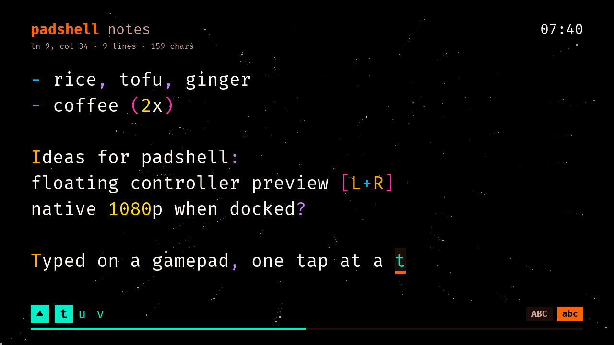
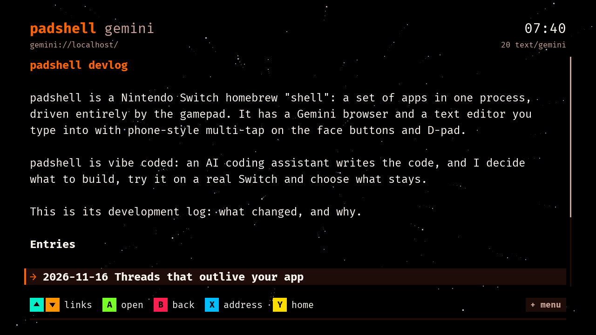

padshell is a Nintendo Switch homebrew "shell": a few apps in one process,
driven entirely by the gamepad. Version 0.0.1 has two of them, a text editor
and a browser for the Gemini protocol.

## Typing without a keyboard

The first version used a daisywheel, the radial picker some consoles use for
text entry. I replaced it with phone-style
**multi-tap**: each face button and D-pad direction holds a group of letters,
so pressing B twice gives `b`, and the character commits after a second or
as soon as you press another group. Holding ZL switches to numbers and
symbols; holding ZR gives newline, space, backspace and cursor movement.

The status line always shows what the buttons will type, and the pending
character appears at the cursor in its button's colour, with a bar counting
down to the commit.

## A Gemini browser

The second app is a [Gemini](https://geminiprotocol.net/) browser. Gemini is
a small, text-first protocol, which suits a gamepad well: the D-pad jumps
between links, the sticks scroll, and the address bar uses the same
multi-tap input. Certificates use trust on first use, as is usual for Gemini.

## Made for a TV

padshell is meant to be read from the couch, so the themes are built for
cheap TVs that wash out pale colours: near-black backgrounds, saturated
accents, and every text colour checked against a minimum contrast ratio.
There are twenty themes and six monospaced fonts, and an optional starfield
drifts behind the text.

## Get it

The `.nro` is on the releases page. Copy it to `/switch/` on the SD card and
start it from the Homebrew Menu.

[padshell on GitHub](https://github.com/hjalves/padshell)
